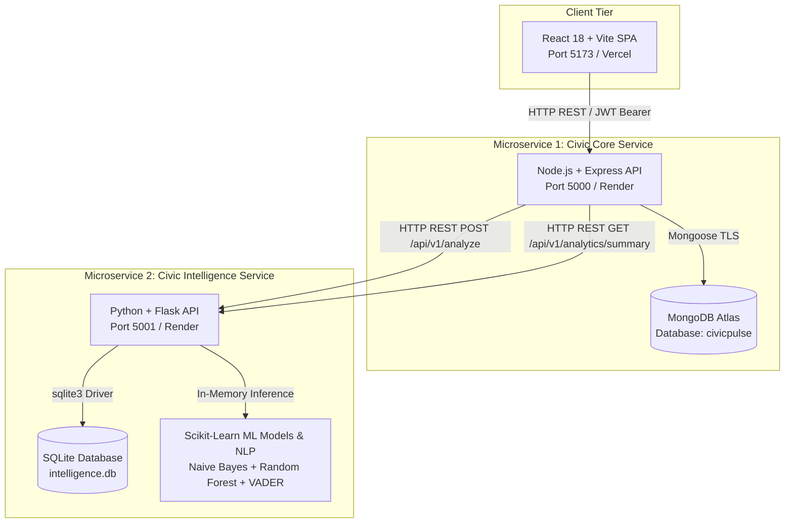

# CivicPulse — AI-Powered Community Complaint Management System
### Enterprise Microservices Architecture Edition (v2.0)

[]()
[]()
[]()
[]()
[]()

---

## 🏛️ 1. Architecture Overview

CivicPulse is refactored into **two independently deployable backend microservices**, a decoupled **React SPA**, and isolated private databases adhering to the **Database-per-Service** design pattern.



---

## ⚙️ 2. Microservice Responsibilities & Data Ownership

| Microservice | Technology | Port | Database | Primary Responsibilities |
| :--- | :--- | :---: | :--- | :--- |
| **Civic Core Service** | Node.js, Express, Mongoose, JWT | `5000` | **MongoDB Atlas** (`civicpulse`) | Citizen auth, complaint CRUD, status lifecycle, comments, upvotes, notifications, and inter-service orchestration. |
| **Civic Intelligence Service** | Python, Flask, Scikit-learn, NLTK | `5001` | **SQLite** (`intelligence.db`) | NLP classification, priority prediction, spam risk assessment, TF-IDF cosine similarity, and analysis history audit CRUD. |
| **Frontend Client** | React 18, Vite, Tailwind CSS, Leaflet | `5173` | Local Storage (JWT) | Citizen grievance dashboard, geospatial map view, interactive submission form, and admin analytics dashboard. |

---

## 🚀 3. Quick Start & Local Execution

### Prerequisites
* **Node.js** v18+ & **npm**
* **Python** 3.12+
* **MongoDB Atlas** account (or local MongoDB on port 27017)

### 1. Install All Dependencies
From the repository root:
```bash
# 1. Root dependencies (concurrently)
npm install

# 2. Civic Core Service dependencies
npm install --prefix server

# 3. Civic Intelligence Service dependencies
pip install -r intelligence_service/requirements.txt

# 4. React Frontend dependencies
npm install --prefix client
```

### 2. Environment Configuration
Verify your environment files:
* Core Service: `server/.env` (contains `PORT=5000`, `MONGO_URI`, `INTELLIGENCE_SERVICE_URL=http://localhost:5001`)
* Intelligence Service: `intelligence_service/.env` (contains `PORT=5001`, `INTELLIGENCE_DB_PATH=intelligence.db`)
* Frontend: `client/.env` (contains `VITE_CORE_API_URL=http://localhost:5000/api/v1`)

*(Clean template files are available in `.env.example` across all service folders).*

### 3. Run Everything with One Command
```bash
npm run dev
```
This concurrently starts:
* 🔵 **Core Service** on `http://localhost:5000`
* 🟣 **Intelligence Service** on `http://localhost:5001`
* 🟢 **React Client** on `http://localhost:5173`

*(Alternatively, run only backend services: `npm run services`).*

---

## 🧪 4. Automated Testing (100% Pass Rate)

CivicPulse includes comprehensive automated test suites for both services:

```bash
# Run ALL test suites across both microservices (28 tests total)
npm test
```

### Run Service Tests Independently:
```bash
# Core Service (20 Jest tests)
npm test --prefix server

# Intelligence Service (8 Python unittest tests)
python -m unittest intelligence_service/tests/test_service.py

# Validate Frontend Production Bundle (Vite)
npm run build --prefix client
```

---

## 📡 5. REST API Endpoints Summary (`/api/v1`)

### Civic Core Service (`http://localhost:5000`)
* `GET /api/v1/health` — Microservice health, MongoDB status, inter-service link
* `POST /api/v1/auth/register` — Citizen registration
* `POST /api/v1/auth/login` — Citizen & Admin authentication (returns JWT)
* `GET /api/v1/auth/me` — Authenticated citizen profile
* `GET /api/v1/complaints` — Filtered & paginated complaint listings
* `POST /api/v1/complaints` — Submit complaint (triggers HTTP call to Intelligence Service)
* `GET /api/v1/complaints/:id` — Complaint detail & discussion thread
* `PUT /api/v1/complaints/:id` — Update complaint details
* `PATCH /api/v1/complaints/:id/status` — Admin update complaint status (Submitted &rarr; In Progress &rarr; Resolved)
* `DELETE /api/v1/complaints/:id` — Remove complaint
* `POST /api/v1/complaints/:id/upvote` — Upvote grievance
* `POST /api/v1/complaints/:id/comments` — Post citizen or official response
* `GET /api/v1/analytics/summary` — Merged analytics combining MongoDB and Intelligence Service SQLite data
* `GET /api/v1/departments` — Municipal department list and SLAs

### Civic Intelligence Service (`http://localhost:5001`)
* `GET /api/v1/health` — Health check, model status, SQLite connectivity
* `POST /api/v1/analyze` — End-to-end AI analysis (persists to SQLite `analysis_history`)
* `POST /api/v1/classify` — Predict civic category & confidence
* `POST /api/v1/predict-priority` — Predict priority (Urgent, High, Medium, Low)
* `POST /api/v1/detect-spam` — Check spam probability and flags
* `POST /api/v1/similar-complaints` — TF-IDF cosine similarity search
* `GET /api/v1/analytics/summary` — Aggregate model accuracy & metrics from SQLite
* `GET /api/v1/history` — List logged prediction history (SQLite CRUD)
* `GET /api/v1/history/:id` — Retrieve single analysis record
* `PUT /api/v1/history/:id` — Update analysis feedback
* `DELETE /api/v1/history/:id` — Delete analysis record

---

## 📮 6. Postman Collection

Import the following files into Postman:
1. `postman/CivicPulse_API.postman_collection.json`
2. `postman/CivicPulse_Local.postman_environment.json`

The collection features automated test assertions and automatically saves the JWT token for subsequent requests.

---

## 📚 7. Project Documentation Index

* 📐 [Architecture Specification](docs/ARCHITECTURE.md)
* 📖 [Complete API Documentation](docs/API_DOCUMENTATION.md)
* 🔄 [Inter-Service Communication Protocol](docs/INTER_SERVICE_COMMUNICATION.md)
* ☁️ [Deployment Guide (Vercel & Render)](docs/DEPLOYMENT.md)
* 🧪 [Testing & Verification Report](docs/TESTING.md)
* 🎓 [Academic Project Report](docs/PROJECT_REPORT.md)
* 🗣️ [Master Viva Preparation Guide (10 Marks)](docs/VIVA_PREPARATION.md)
