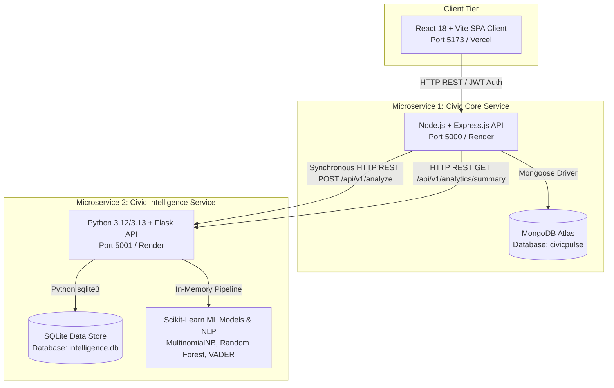
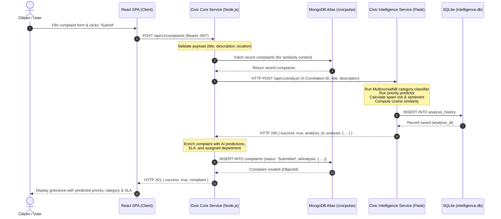

# CivicPulse — Microservices Architecture Specification

## 1. System Overview

**CivicPulse** is an AI-powered community grievance redressal and municipal complaint management platform. The application is architected into **two independent backend microservices**, a decoupled **React SPA frontend**, and independent database layers.

---

## 2. Service Separation & Domain Boundaries

### Microservice 1: Civic Core Service
* **Technology Stack**: Node.js, Express.js, Mongoose, JWT, Axios, Jest, Supertest.
* **Port**: `5000` (configurable via `PORT`).
* **Domain Ownership**: Core civic grievance lifecycle, citizen identity, authentication, role-based authorization, comment threads, upvotes, municipal routing, and notifications.
* **Data Ownership**: Dedicated connection to **MongoDB Atlas** (`civicpulse` database). Owns collections:
  * `users`
  * `complaints`
  * `departments`
  * `comments`
  * `notifications`
* **API Prefix**: `/api/v1` (with `/api` compatibility aliases).

### Microservice 2: Civic Intelligence Service
* **Technology Stack**: Python 3.12+, Flask, Flask-CORS, Scikit-learn, NLTK, SQLite.
* **Port**: `5001` (configurable via `PORT` / `INTELLIGENCE_PORT`).
* **Domain Ownership**: Natural Language Processing, machine learning categorization, priority forecasting, spam risk assessment, TF-IDF cosine similarity detection, sentiment scoring, and AI analysis auditing.
* **Data Ownership**: Dedicated connection to **SQLite** (`intelligence.db`). Owns tables:
  * `analysis_history` (stores all prediction audit trails with correlation IDs)
  * `audit_logs` (tracks service and model lifecycle events)
* **API Prefix**: `/api/v1`.

---

## 3. Mandatory Inter-Service Communication Sequence

The following sequence diagram details the end-to-end communication between the React Frontend, Civic Core Service, and Civic Intelligence Service during complaint submission:

---

## 4. Resilience, Bounded Retries & Fallback Strategy

To ensure zero complaint loss in production, Civic Core Service implements a **Circuit Breaker / Fallback** pattern:
1. **Timeout**: The Core Service limits inter-service HTTP requests to **4500ms**.
2. **Graceful Fallback**: If the Intelligence Service is unreachable or times out, the Core Service immediately falls back to local heuristic rule-based classification (`serviceStatus: 'fallback'`).
3. **Auditability**: The complaint is safely stored in MongoDB Atlas with a `pending-analysis` or `fallback` flag so a background worker can re-analyze it without user disruption.

---

## 5. Database Ownership Matrix

| Entity / Table | Database | Owning Microservice | Sharing Mode |
| :--- | :--- | :--- | :--- |
| `users` | MongoDB Atlas (`civicpulse`) | Civic Core Service | Private to Core Service |
| `complaints` | MongoDB Atlas (`civicpulse`) | Civic Core Service | Private to Core Service |
| `departments` | MongoDB Atlas (`civicpulse`) | Civic Core Service | Private to Core Service |
| `comments` | MongoDB Atlas (`civicpulse`) | Civic Core Service | Private to Core Service |
| `notifications` | MongoDB Atlas (`civicpulse`) | Civic Core Service | Private to Core Service |
| `analysis_history` | SQLite (`intelligence.db`) | Civic Intelligence Service | Private to Intelligence Service |
| `audit_logs` | SQLite (`intelligence.db`) | Civic Intelligence Service | Private to Intelligence Service |
