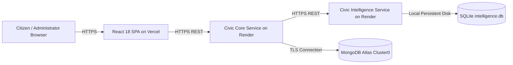

# CivicPulse — Microservices Deployment Guide

This guide details the steps to deploy each component of CivicPulse independently to production cloud environments (Vercel & Render).

---

## 1. Deployment Topology

---

## 2. Component 1: React Frontend (Deploy to Vercel)

### Configuration Files
* **Root Directory**: `client`
* **Build Command**: `npm run build`
* **Output Directory**: `dist`
* **Framework Preset**: Vite

### Environment Variables on Vercel
| Variable Name | Example Production Value | Description |
| :--- | :--- | :--- |
| `VITE_CORE_API_URL` | `https://civicpulse-backend.onrender.com/api/v1` | Public HTTPS URL of deployed Core Service |
| `VITE_INTELLIGENCE_API_URL` | `https://civicpulse-intelligence.onrender.com/api/v1` | Public HTTPS URL of deployed Intelligence Service |

### Steps:
1. Push repository to GitHub.
2. In Vercel Dashboard, click **Add New Project** &rarr; Select repository.
3. Set **Root Directory** to `client`.
4. Add the environment variables above and click **Deploy**.

---

## 3. Component 2: Civic Core Service (Deploy to Render)

### Configuration Files
* **Root Directory**: `server`
* **Environment**: Node
* **Build Command**: `npm install`
* **Start Command**: `node server.js`
* Configuration file: `server/render.yaml`

### Environment Variables on Render
| Variable Name | Example Production Value | Description |
| :--- | :--- | :--- |
| `NODE_ENV` | `production` | Production runtime flag |
| `PORT` | `10000` | Port assigned by Render |
| `MONGO_URI` | `mongodb+srv://<user>:<pwd>@cluster0.733tbp7.mongodb.net/civicpulse?retryWrites=true&w=majority` | MongoDB Atlas URI |
| `JWT_SECRET` | `super_secure_random_jwt_secret_key` | Secret key for JWT signing |
| `CLIENT_URL` | `https://civicpulse.vercel.app` | Vercel production frontend URL |
| `INTELLIGENCE_SERVICE_URL` | `https://civicpulse-intelligence.onrender.com` | Deployed Intelligence Service URL |
| `INTELLIGENCE_SERVICE_TIMEOUT_MS` | `5000` | HTTP request timeout |

### Verification:
After deployment, visit `https://<your-render-app>.onrender.com/api/v1/health`. It must return HTTP 200 with `status: "healthy"`.

---

## 4. Component 3: Civic Intelligence Service (Deploy to Render)

### Configuration Files
* **Root Directory**: `intelligence_service`
* **Environment**: Python
* **Build Command**: `pip install -r requirements.txt`
* **Start Command**: `gunicorn app:app --bind 0.0.0.0:$PORT`
* Configuration file: `intelligence_service/render.yaml`

### Environment Variables on Render
| Variable Name | Example Production Value | Description |
| :--- | :--- | :--- |
| `PYTHON_VERSION` | `3.12.0` | Python runtime version |
| `PORT` | `10000` | Port assigned by Render |
| `INTELLIGENCE_DB_PATH` | `/var/data/intelligence.db` | Path to persistent disk SQLite DB |
| `CORS_ORIGIN` | `*` | Allowed CORS origins |

### Verification:
Visit `https://<your-intelligence-app>.onrender.com/api/v1/health`. It must return HTTP 200 with `models_ready: true`.

---

## 5. End-to-End Verification Checklist

1. **Service Health**:
   - `curl https://<core-url>/api/v1/health` &rarr; `status: "healthy"`
   - `curl https://<intelligence-url>/api/v1/health` &rarr; `status: "healthy"`
2. **Inter-Service Communication**:
   - Submit a test complaint via the deployed React frontend.
   - Verify that the complaint shows predicted category, priority, and assigned department.
   - Verify in MongoDB Atlas that the document contains `aiAnalysis.serviceStatus: "completed"`.
3. **CORS Validation**:
   - Ensure network tab shows HTTP 200/201 on API requests from the frontend without CORS blocking.
