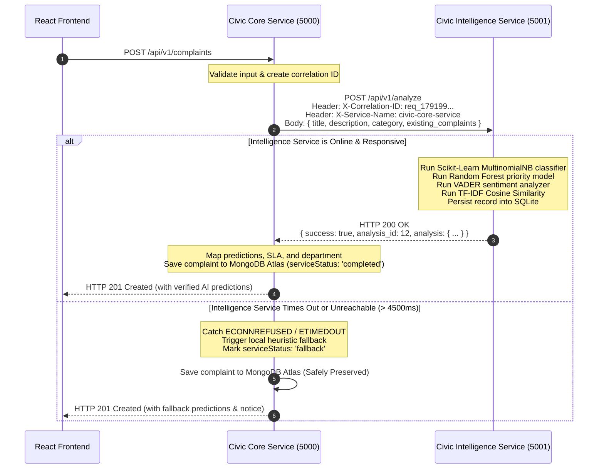

# CivicPulse — Inter-Service REST Communication Protocol

## 1. Overview & Protocol Specification

In accordance with Microservices Architecture design patterns, **Civic Core Service** (Node.js/Express) and **Civic Intelligence Service** (Python/Flask) communicate through synchronous **HTTP/1.1 REST API requests** over standard TCP/IP.

* **Network Protocol**: HTTP REST (JSON payload)
* **Client Library**: Axios with timeout handlers and connection pooling (Core Service)
* **Server Framework**: Flask WSGI with multi-threaded request processing (Intelligence Service)
* **Default Timeout**: `4500ms` (configurable via `INTELLIGENCE_SERVICE_TIMEOUT_MS`)
* **Tracking & Traceability**: Each request carries an `X-Correlation-ID` HTTP header for distributed tracing.

---

## 2. Complaint Submission & Analysis Workflow



---

## 3. Payload Contracts

### Core Service Request (`POST /api/v1/analyze`)
```json
{
  "title": "Broken water pipeline flooding road",
  "description": "High pressure pipe burst near market. Clean water flowing onto street.",
  "category": "Water",
  "complaint_id": "temp_670da414",
  "existing_complaints": [
    {
      "id": "660e1d0f5e71826b52a12302",
      "title": "Drinking water pipeline burst near Gandhipuram",
      "description": "Clean water is flowing onto road.",
      "category": "Water"
    }
  ]
}
```

### Intelligence Service Response (`200 OK`)
```json
{
  "success": true,
  "analysis_id": 12,
  "stored_in_sqlite": true,
  "correlation_id": "req_1791997930665",
  "analysis": {
    "category": "Water",
    "category_confidence": 0.94,
    "priority": "High",
    "priority_confidence": 0.88,
    "spam_score": 0.0,
    "is_spam": false,
    "spam_flags": [],
    "sentiment_score": -0.65,
    "urgency_score": 0.85,
    "department": "Water & Sewage",
    "similar_complaints": [
      {
        "id": "660e1d0f5e71826b52a12302",
        "title": "Drinking water pipeline burst near Gandhipuram",
        "category": "Water",
        "similarity": 0.82
      }
    ],
    "similar_count": 1,
    "model_version": "v1.0.0-advanced"
  }
}
```

---

## 4. Secondary Inter-Service Workflow: Integrated Analytics

When an administrator accesses the CivicPulse Analytics dashboard:
1. React Frontend issues `GET /api/v1/analytics/summary` to Civic Core Service.
2. Civic Core Service executes MongoDB aggregation queries for resolution rates, complaint counts, and status distribution.
3. Civic Core Service issues `GET /api/v1/analytics/summary` to Civic Intelligence Service via HTTP.
4. Civic Intelligence Service reads SQLite `analysis_history` to compute model accuracy, spam rates, and sentiment trends.
5. Civic Core Service merges the operational and AI metrics into an integrated payload returned to the frontend.

---

## 5. Fault Tolerance & Zero Data Loss Guarantee

1. **No Silent Drops**: A failure in the AI service never causes a citizen's complaint to be lost or dropped.
2. **Circuit Protection**: Bounded timeouts prevent HTTP socket exhaustion.
3. **Idempotence**: Re-analyzing a complaint simply records a new audit record without corrupting existing records.
4. **Independent Databases**: Neither service ever connects directly to the other's database, preserving microservice isolation and autonomy.
